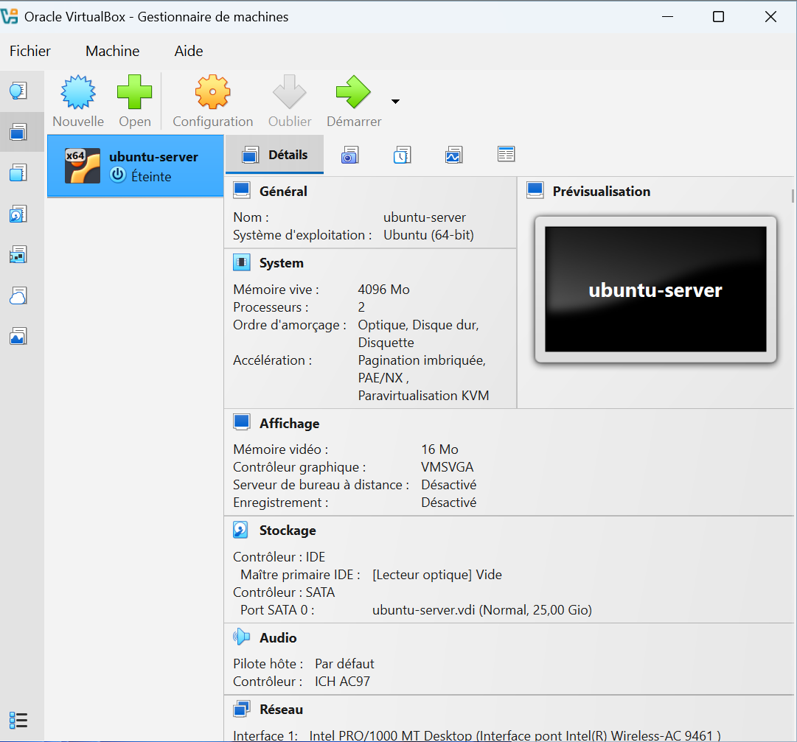

# Step 1: Create the VM

## Goal
Create a VirtualBox virtual machine and install Ubuntu Server 24.04 LTS.

## VM settings

| Setting | Value |
|---|---|
| Name | `ubuntu-server` |
| ISO | `ubuntu-24.04.4-live-server-amd64.iso` |
| Base memory | 4096 MB |
| Processors | 2 |
| Disk | 25 GB (VDI) |
| Chipset | PIIX3 |
| Firmware | UEFI disabled (BIOS mode), Secure Boot off |
| Graphics controller | VMSVGA, 16 MB, 3D acceleration off |
| Network | Bridged adapter |
| Boot order | Optical first, then hard disk (floppy disabled) |

## Installer choices

| Screen | Choice |
|---|---|
| Language | English |
| Installer update | Continue without updating |
| Keyboard | French (AZERTY) |
| Network | DHCP, got `192.168.1.64/24` on `enp0s3` |
| Proxy / mirror | Defaults |
| Storage | Entire disk, LVM, no encryption |
| Profile | server name `ubuntu-server`, user `asma` |
| SSH | Install OpenSSH server |
| Featured snaps | None |

Resulting layout: `/boot` 2 GB, `/` about 11.5 GB (LVM), about 11.5 GB free in the volume group.

## Issue: boot freeze

**Symptom:** the VM stopped at `Begin: Loading essential drivers ...` and never reached the installer.

**Troubleshooting and configuration steps applied:**

| # | Where | Change | Why |
|---|---|---|---|
| 1 | VM Settings → System → Motherboard | Floppy unchecked; **Optical** moved first, **Hard disk** second | Make the VM boot from the ISO first |
| 2 | Same page | **UEFI** tested on and off (Secure Boot left off) | The firmware mode can change how the installer boots |
| 3 | System → Processor | 2 processors, **PAE/NX** enabled | Required CPU features for the 64-bit guest |
| 4 | System → Acceleration | Paravirtualization interface set to **KVM** (or Default); nested VT-x/AMD-V enabled if available | Better hypervisor compatibility |
| 5 | Settings → Storage | Optical drive points to `ubuntu-24.04.4-live-server-amd64.iso`, **Live CD/DVD** checked | Make sure the ISO is really attached |
| 6 | Windows host (PowerShell as administrator) | `bcdedit /set hypervisorlaunchtype off`, then PC reboot | Hyper-V can stay active on Windows even when disabled in the settings and conflicts with VirtualBox |
| 7 | Windows Security → Device security → Core isolation | **Memory integrity** turned off | It keeps the Windows hypervisor running |

Earlier checks: graphics controller **VMSVGA** with 16 MB and 3D acceleration off.

**Final firmware setting:** UEFI disabled (BIOS mode).

**Result:** after these changes the installer started and the installation completed.

**Lesson:** disabling Hyper-V in "Windows Features" is not always enough. The hypervisor launch type and Memory integrity must also be off for VirtualBox to run at full speed.

## Post-install note

After "Reboot now", the message `Failed unmounting cdrom.mount - /cdrom` appeared. This is common with VirtualBox: press Enter, and remove the ISO from the virtual optical drive if the installer restarts.

## Result
Ubuntu Server boots and shows the `ubuntu-server login:` prompt.
