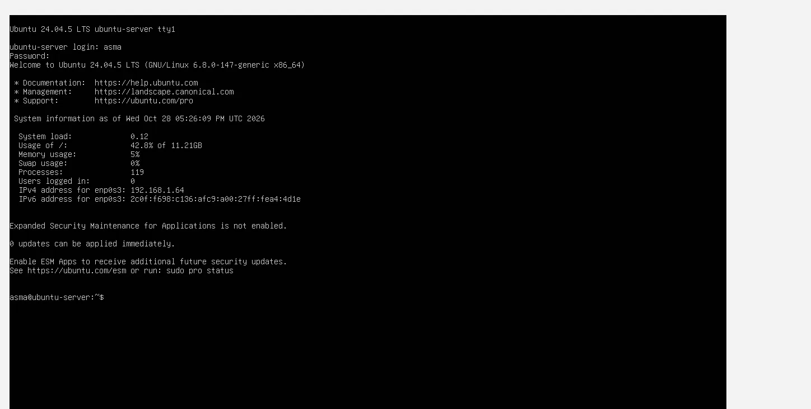

# Step 2: Configure Linux

## Goal
Bring the freshly installed system to a clean, up-to-date, usable state.

## 1. Log in
Log in on the VirtualBox console as `asma`. Ubuntu has no root password: administrative commands use `sudo`.



## 2. Update the system
```bash
sudo apt update && sudo apt upgrade -y
```
During the upgrade, the `keyboard-configuration` package asked for the keyboard layout (French chosen). After a reboot the system reports Ubuntu 24.04.5 LTS and `0 updates can be applied`.

```bash
sudo reboot
```

## 3. Keyboard layout
Temporary (current session):
```bash
sudo loadkeys fr
```
Permanent:
```bash
sudo dpkg-reconfigure keyboard-configuration
```
The layout is **French (AZERTY)**.

## 4. Network check
```bash
ip a
```
The interface `enp0s3` has `192.168.1.64/24` (bridged, DHCP). The MAC address is `08:00:27:a4:4d:1e`; reserving the address in the router keeps it stable.

## 5. Use the whole disk (optional, not applied)
The installer leaves about half of the volume group unused. This step was **skipped**: the root filesystem (about 11 GB) is enough for this project. To use the free space later:
```bash
sudo lvextend -r -l +100%FREE /dev/ubuntu-vg/ubuntu-lv
df -h /
```

## Useful commands learned

| Command | Purpose |
|---|---|
| `sudo` | Run a command as administrator |
| `ip a` | Show network interfaces and addresses |
| `df -h` | Show disk usage |
| `systemctl status <service>` | Show a service state (`q` closes the pager) |


## Result
System up to date, keyboard configured, network address known.
