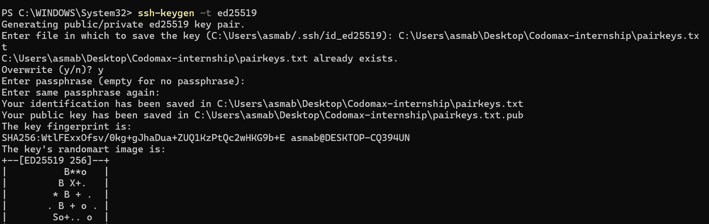
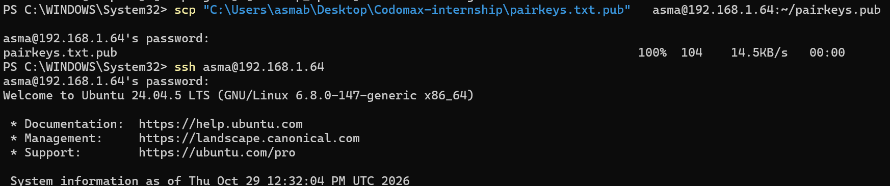
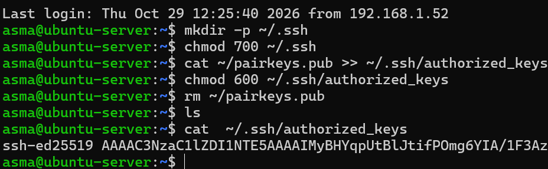

# Step 3: Secure Access

## Goal
Replace simple password login with strong, layered protection for SSH.

Background reading: [SSH keys, SSH vs SSL/TLS vs OpenSSL](ssh-ssl-openssl-concepts.pdf)

## Overview

| Layer | Tool | Purpose | Status |
|---|---|---|---|
| Authentication | SSH ed25519 key + passphrase | Only the key owner can log in | ✅ |
| SSH hardening | `sshd_config.d/01-hardening.conf` | No passwords, no root login | ✅ |
| Firewall | UFW | Only needed ports open | ✅ |
| Brute-force protection | Fail2ban | Ban repeated failures | ✅ |
| Updates | unattended-upgrades | Automatic security patches | ✅ |

## 1. Generate the key pair (Windows PowerShell)
```powershell
ssh-keygen -t ed25519
```
- ed25519: modern elliptic-curve algorithm, short keys, fast, secure.
- A **passphrase** encrypts the private key on disk, so a stolen file is useless alone.
- Output: a private key (never shared) and a public key (`.pub`).

The private key is stored **outside** this repository.



## 2. Copy the public key to the server
Piping the key through `ssh` aborted on Windows (`Connection aborted`), so it is done in two steps.

First connection: SSH asks to confirm the **host key fingerprint** (the server's identity). The fingerprint matched the one shown on the VM console, so `yes` was entered and the server was saved in `known_hosts`.

Copy (Windows):
```powershell
scp "<path-to>\public-key.pub" asma@192.168.1.64:~/pairkeys.pub
```


Install (on the server):
```bash
mkdir -p ~/.ssh
chmod 700 ~/.ssh
cat ~/pairkeys.pub >> ~/.ssh/authorized_keys
chmod 600 ~/.ssh/authorized_keys
rm ~/pairkeys.pub
```


Copying only places a file on the server. **Installing** it in `authorized_keys` is what makes SSH accept the key. `>>` appends; `>` would overwrite existing keys. The `chmod` values matter because SSH refuses keys with loose permissions.

## 3. Test the key login (before any hardening)
```powershell
ssh -i "<path-to>\private-key" asma@192.168.1.64
```
Expected: SSH asks for the **key passphrase**, not the server password.


> Do not disable password login until this works, or you may lock yourself out.

## 4. Optional: ssh-agent (type the passphrase once)
Windows PowerShell, administrator:
```powershell
Get-Service ssh-agent | Set-Service -StartupType Automatic
Start-Service ssh-agent
ssh-add "<path-to>\private-key"
```

## 5. Harden the SSH server
File: [`configs/01-hardening.conf`](../configs/01-hardening.conf)
```bash
sudo nano /etc/ssh/sshd_config.d/01-hardening.conf
sudo sshd -t
sudo systemctl restart ssh
```
The `01-` prefix makes it load before the cloud-init file that enables passwords (first value wins). Keep the current SSH session open and test a second connection before closing it.


## 6. Firewall (UFW)
Rules: [`configs/ufw-rules.txt`](../configs/ufw-rules.txt)
```bash
sudo ufw allow OpenSSH
sudo ufw enable
sudo ufw status
```

## 7. Fail2ban
```bash
sudo apt install fail2ban -y
sudo systemctl enable --now fail2ban
sudo fail2ban-client status sshd
```

## 8. Automatic security updates
```bash
sudo apt install unattended-upgrades -y
sudo dpkg-reconfigure -plow unattended-upgrades
```

## Verification

| Test | Command | Expected | Result |
|---|---|---|---|
| Key login works | `ssh -i <key> asma@192.168.1.64` | Passphrase prompt, shell opens | ✅ Passed |
| Password login refused | `ssh -o PubkeyAuthentication=no asma@192.168.1.64` | `Permission denied (publickey)` | ✅ Passed |
| Firewall active | `sudo ufw status` | Status: active | ✅ Passed |
| Fail2ban running | `sudo fail2ban-client status sshd` | Jail listed | ✅ Passed |


## Result
All four checks passed. SSH accepts only the ed25519 key, password and root logins are refused, UFW is active, and Fail2ban is running.
