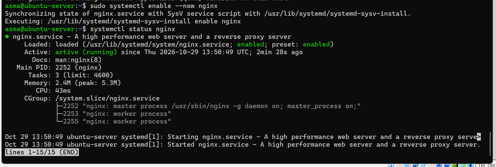
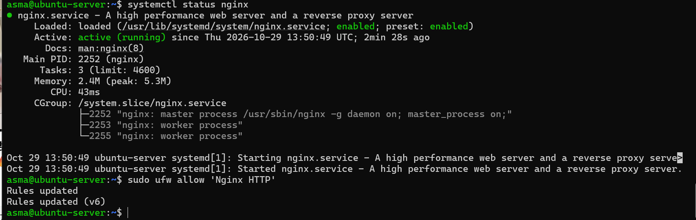

# Step 4: Deploy Service

## Goal
Run a useful network service on the server and make it reachable. Chosen service: **Nginx** web server.

## What "deploying a service" means
A service is a background program answering requests from other machines. Deploying it means installing, configuring, starting, exposing (firewall) and verifying it.

## 1. Install and start
```bash
sudo apt install nginx -y
sudo systemctl enable --now nginx
systemctl status nginx --no-pager
```
Observed: `enabled` (starts at boot) and `active (running)`, with one master and two worker processes.



## 2. Open the firewall
```bash
sudo ufw allow 'Nginx HTTP'
sudo ufw status
```
SSH must be allowed first (`sudo ufw allow OpenSSH`) to avoid locking yourself out.



## 3. Customize the page
Files: [`configs/index.html`](../configs/index.html), [`configs/nginx-site.conf`](../configs/nginx-site.conf)
```bash
sudo nano /var/www/html/index.html
sudo nginx -t
sudo systemctl reload nginx
```


## 4. Useful commands

| Command | Purpose |
|---|---|
| `sudo nginx -t` | Check configuration syntax |
| `sudo systemctl reload nginx` | Apply changes without downtime |
| `sudo tail -f /var/log/nginx/access.log` | Watch requests live |
| `ss -tlnp` | List listening ports |

## Optional: HTTPS
A self-signed certificate can be created with OpenSSL (see the concepts PDF) and configured in Nginx on port 443.

## Result
Nginx is running and enabled at boot. Reachability is verified in [step 5](05-test-connectivity.md).
