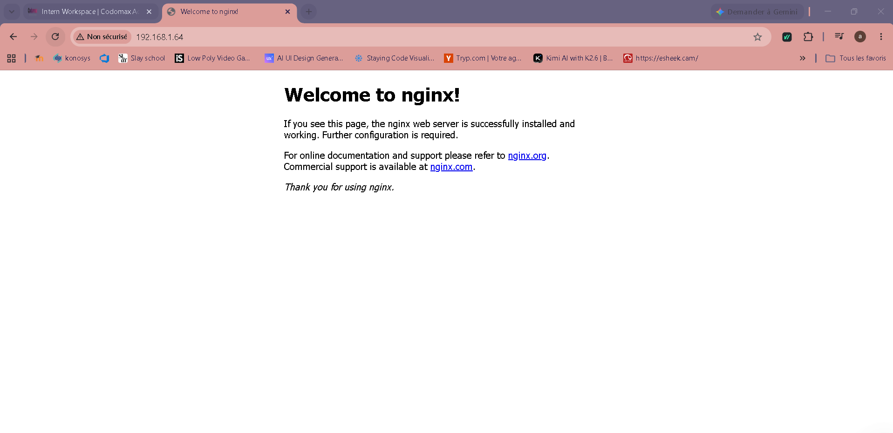
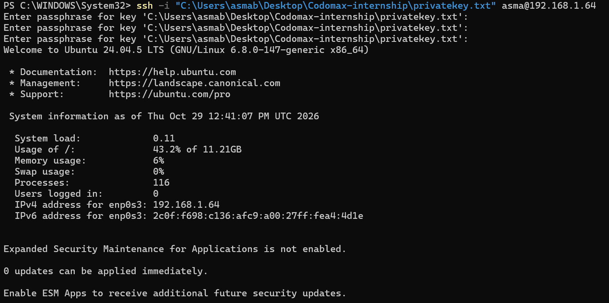

# Step 5: Test Connectivity

## Goal
Prove that the service is reachable from another machine, and that the security rules behave as intended.

## Test matrix

| # | Test | Where | Command / action | Expected | Result |
|---|---|---|---|---|---|
| 1 | Service runs | Server | `systemctl status nginx --no-pager` | active (running) | ✅ Passed |
| 2 | Local HTTP | Server | `curl localhost` | HTML of the page | ✅ Passed |
| 3 | Port listening | Server | `ss -tlnp` | `:80` and `:22` listening | ✅ Passed |
| 4 | Network reachability | Windows | `ping 192.168.1.64` | Replies | ✅ Passed |
| 5 | Port 80 open | Windows | `Test-NetConnection 192.168.1.64 -Port 80` | `TcpTestSucceeded : True` | ✅ Passed |
| 6 | Web page | Windows browser | `http://192.168.1.64` | Nginx / custom page | ✅ Passed |
| 7 | HTTP via CLI | Windows | `curl http://192.168.1.64` | HTTP 200 and HTML | ✅ Passed |
| 8 | SSH with key | Windows | `ssh -i <key> asma@192.168.1.64` | Passphrase prompt, shell | ✅ Passed |
| 9 | Password SSH refused | Windows | `ssh -o PubkeyAuthentication=no asma@192.168.1.64` | `Permission denied (publickey)` | ✅ Passed |
| 10 | Closed port blocked | Windows | `Test-NetConnection 192.168.1.64 -Port 3306` | `TcpTestSucceeded : False` | ✅ Passed |

Web page reached from the Windows host:

SSH login with the key:

## Troubleshooting guide

| Symptom | Likely cause | Check |
|---|---|---|
| Page does not load | Service stopped | `systemctl status nginx` |
| Timeout from Windows only | Firewall blocks port | `sudo ufw status` |
| Connection refused | Nothing listening | `ss -tlnp` |
| Wrong address | DHCP changed the IP | `ip a` on the server |
| Bridged network not working | Wrong host adapter in VirtualBox | VM settings, Network |

## Conclusion
All ten tests passed. The service is reachable from the Windows host, SSH works with the key only, and closed ports are blocked by the firewall.
